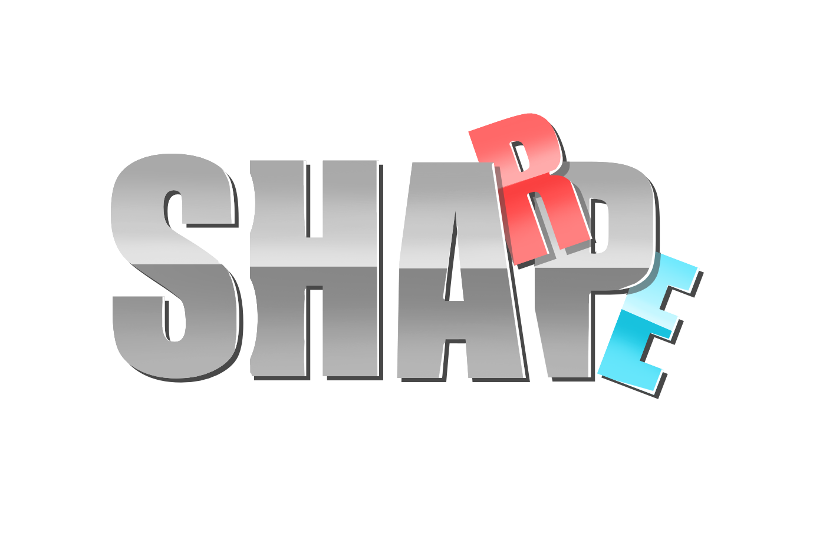

<p align="center"></p>

<p align="center">
  <b>Extract the small-molecule binding pockets of RNA structures and describe their shape and structure.</b><br>
  Command-line companion of the <a href="https://sharpshape.rpbs.univ-paris-diderot.fr">SharpShape web server</a>.<br>
  Method: <a href="https://doi.org/10.34133/csbj.0022">Ziani et al., Comput. Struct. Biotechnol. J. 2026</a>.
</p>

---

## What it does

Give it an RNA-ligand structure (PDB file). For each bound small molecule, `sharpshape`:

1. **extracts the pocket**: the RNA nucleotides with at least one heavy atom within 6 Å of the ligand.
2. **describes its shape**: eigenvalues of the atom coordinates, size-independent ratios (rEV21, rEV32, rEV31) and the
   shape archetype (sphere, disk, rod or anisotropic).
3. **describes its RNA structure**: base pairs (canonical and non-canonical), stacking, backbone links,
   secondary-structure motifs (stems, loops, junctions, pseudoknots) and nucleotide composition.

The definitions are exactly those of the RNA pocket atlas: on the atlas structures, the tool reproduces the atlas values
(see [Validation](#validation)). The [web server](https://sharpshape.rpbs.univ-paris-diderot.fr) runs the same code with an
interactive interface and compares each pocket with the reference pockets of the atlas. This repository is for local use
and for many structures at once.

| You want to… | Use |
|---|---|
| analyse one structure interactively, see the pocket in 3D and its closest atlas pockets | the [web server](https://sharpshape.rpbs.univ-paris-diderot.fr) |
| analyse many structures, or work offline, or include the descriptors in your own pipeline | this command-line tool |

## Contents

[Quick start](#quick-start) · [Example](#example) · [Usage](#usage) · [Output](#output-one-row-per-pocket) ·
[Shape archetypes](#shape-archetypes) · [Validation](#validation) · [Troubleshooting](#troubleshooting) ·
[How to cite](#how-to-cite) · [Licence](#licence) · [Contact](#contact)

## Quick start

Linux, no administrator rights needed. Requirements: `git`, `bash` and Python 3.12 (`python3.12`). If Python 3.12 is
missing, the installer downloads it with [uv](https://docs.astral.sh/uv/) (needs `curl`).

```bash
git clone https://github.com/ZianiL/sharpshape.git
cd sharpshape
bash install.sh                                 # about 1-2 minutes, ~1 GB, all in this folder
.venv/bin/python tests/test_against_atlas.py    # check: "5/5 atlas pockets identical"
.venv/bin/sharpshape tests/data/4LVV.pdb -o pockets.csv
```

## Example

`tests/data/4LVV.pdb` is the THF riboswitch (PDB 4LVV) with two bound folinic acid molecules (ligand code FFO):

```text
$ .venv/bin/sharpshape tests/data/4LVV.pdb -o pockets.csv
tests/data/4LVV.pdb: 2 pocket(s)

2 pocket(s) written to pockets.csv | 1 file(s): 1 read (0 without pocket), 0 failed
```

`pockets.csv` has one row per pocket (63 columns, a few of them shown here):

| PDB_Pocket | Num_Residues | rEV21 | rEV32 | archetype | non.canonical.bp |
|---|---|---|---|---|---|
| 4lvv_FFO_101-A | 9 | 0.448 | 0.746 | rod | 3 |
| 4lvv_FFO_102-A | 8 | 0.307 | 0.855 | rod | 2 |

The `residues` column lists the pocket nucleotides (for the first pocket: `AA8;AA80;AC79;AG41;AG44;AG78;AU35;AU42;AU7`,
i.e. chain, nucleotide, number).

## Usage

```bash
# one structure
.venv/bin/sharpshape structure.pdb -o pockets.csv
# also save each pocket as a PDB file
.venv/bin/sharpshape structure.pdb -o pockets.csv --pockets-dir out/
# many structures, one CSV
.venv/bin/sharpshape my_structures/*.pdb -o all_pockets.csv
# pockets you have already extracted
.venv/bin/sharpshape --pocket-files my_pockets/*.pdb -o pockets.csv
```

| Option | Meaning | Default |
|---|---|---|
| `-o`, `--output` | output CSV file | `pockets.csv` |
| `--cutoff` | distance from the ligand, in Å | 6.0 (atlas) |
| `--level residue\|atom` | whole nucleotides (atlas) or only the atoms within the cutoff | `residue` |
| `--pockets-dir DIR` | also write each pocket as `DIR/pockets/<pdb>/<pocket>/pocket.pdb` | not written |
| `--pocket-files` | the inputs are already extracted pockets (no extraction) | off |

**Input.** PDB format. The first model is used and hydrogens are ignored. Water and ions are not treated as ligands.

**Many structures.** Every pocket of every file goes into the same CSV (columns `PDB` and `Pocket`). Each file is
reported on the screen: `N pocket(s)`, `no pocket` (readable structure without a ligand pocket) or `ERROR` (file that
cannot be read). A summary is printed at the end, and the exit code is 1 if any file failed. About 2-3 s per structure on
a laptop. For thousands of files, run batches of 500:

```bash
ls my_structures/*.pdb | xargs -n 500 sh -c '.venv/bin/sharpshape "$@" -o "batch_$$.csv"' _
```

**Pockets you have already extracted** (`--pocket-files`). Each file is treated as one pocket: its nucleotides (A, U, G, C,
and modified nucleotides recognised by their C1′ atom) are kept, heavy atoms only. A ligand, water or ions left in the file
are ignored. Size, shape, archetype, composition and steps are computed. Base pairs, stacking, backbone links and
secondary-structure motifs need the whole structure, so they are left empty. Pocket name: `<file name>_pocket`.

**What is a ligand.** Any non-polymer, non-solvent HETATM residue that is not covalently linked to the RNA backbone (a
5′-triphosphate G or an in-chain modified nucleotide is part of the RNA). Pockets with fewer than 2 nucleotides are
skipped. Modified nucleotides are kept in the pocket and listed (`modified_nt`), but the atlas itself excludes
pockets containing them. Pocket name: `<ligand>_<residue number>-<chain>`.

## Output (one row per pocket)

| Columns | Meaning |
|---|---|
| `PDB_Pocket`, `PDB`, `Pocket`, `LIG` | identifiers: structure, pocket, ligand code |
| `Num_Residues`, `Num_Atoms` | size: nucleotides and heavy atoms of the pocket |
| `EV1`, `EV2`, `EV3`, `R_gyration` | eigenvalues of the covariance matrix of the atom coordinates (largest first), radius of gyration = √(EV1 + EV2 + EV3) |
| `rEV21`, `rEV32`, `rEV31` | shape ratios EV2/EV1 (elongation), EV3/EV2 (cross-section) and EV3/EV1, between 0 and 1, independent of size |
| `archetype` | shape archetype: `sphere`, `disk`, `rod` or `anisotropic` (see below) |
| `canonical.bp`, `non.canonical.bp` | base pairs with both nucleotides in the pocket. Canonical: Watson-Crick and G-U wobble (Saenger XIX, XX, XXVIII) |
| `stacking` | stacked nucleotide pairs within the pocket |
| `covalent.bonds` | backbone links between consecutive pocket nucleotides (O3′-P ≤ 2.0 Å), not ligand bonds |
| `stem`, `hairpin-loop`, `bulge`, `internal-loop`, `junction-loop`, `ss-non-loop`, `pseudoknotted` | 1 if at least one pocket nucleotide is in this motif, else 0 |
| `A`, `U`, `C`, `G`, `n_modified` | nucleotide counts |
| `step_XY` (16 columns) | ordered dinucleotide steps along backbone links, 5′→3′ |
| `GU` … `AA`, `UGG` … `GUC` | additional panels: unordered dinucleotides and selected trinucleotides |
| `modified_nt`, `residues` | modified nucleotides kept, and the list of pocket nucleotides |

Annotation tools: base pairs and secondary structure come from RNApolis 0.16.17 (`--find-gaps --decompose-pseudoknot-free`), and stacking from RNApolis 0.4.10, as in the atlas. Stems have at least 2 canonical
pairs, including pseudoknotted stems, and loops are typed by their number of strands.

## Shape archetypes

The shape of a pocket is summarized by two size-independent ratios of the eigenvalues of its atom coordinates: rEV21
(how elongated it is) and rEV32 (how round its cross-section is). Splitting each ratio at its median over the
reference subset of the atlas (278 pockets: rEV21 = 0.5896, rEV32 = 0.5433) gives four archetypes:

|  | rEV32 ≥ 0.5433 | rEV32 < 0.5433 |
|---|---|---|
| **rEV21 ≥ 0.5896** | `sphere` | `disk` |
| **rEV21 < 0.5896** | `rod` | `anisotropic` (strongly anisotropic) |

The framework and its RNA/protein comparison are described in the method article (Ziani et al., *Comput. Struct.
Biotechnol. J.* 2026). The thresholds used here are those of the RNA pocket atlas.

## Validation

`tests/test_against_atlas.py` runs the tool on three public PDB entries (`tests/data/`: 1AJU, 3SKI, 4LVV) and compares
their five atlas pockets with the atlas values (`tests/expected_atlas_pockets.csv`, 40 descriptors), then gives the
extracted pockets back as pocket files (`--pocket-files`) and checks them again (29 descriptors). Expected result:

```text
5/5 atlas pockets identical (6 pockets found in the test structures, 40 descriptors compared)
5/5 pocket files identical (29 descriptors compared)
```

Applied to the 455 atlas structures, the tool reproduces the descriptors of all 820 atlas pockets.

## Troubleshooting

| Problem | Solution |
|---|---|
| `ERROR` for a `.cif` file | only the PDB format is read: convert the mmCIF file to PDB first (for example with PyMOL: `load file.cif` then `save file.pdb`) |
| `python3.12 not found` | the installer downloads Python 3.12 with uv (needs `curl` and internet access) |
| `no pocket` for a structure | the file has no small-molecule ligand that is not covalently linked to the RNA, or every pocket has fewer than 2 nucleotides |
| empty base-pair or motif columns | expected with `--pocket-files`: these descriptors need the whole structure |

Everything is installed inside the folder: `.venv/` (the `sharpshape` command, pinned versions in
`requirements-lock.txt`) and `tools/rnapolis-0.16.17/` (pinned in `tools/requirements-rnapolis.txt`). Two environments are
used because stacking comes from RNApolis 0.4.10 and the other annotations from RNApolis 0.16.17. To uninstall, delete
the folder (and `~/.local/bin/uv` if the installer added it).

## How to cite

If you use sharpshape, please cite:

- Ziani L, Badel A, Dufay L, Flatters D, Regad L, Camproux A-C. Eigenvalue ratios reveal shared binding pocket shapes in
  RNA and protein structures. *Comput. Struct. Biotechnol. J.* 2026;35:0022.
  [doi:10.34133/csbj.0022](https://doi.org/10.34133/csbj.0022)
- the RNA pocket atlas article (Ziani et al., in preparation).

GitHub's "Cite this repository" button (from `CITATION.cff`) gives the reference of this software.

## Licence

MIT licence (see [`LICENSE`](LICENSE)). The atlas data are distributed separately under CC BY 4.0 (Zenodo record of the
article).

Third-party software, installed by `install.sh` and not redistributed here (licences as declared in each package):
RNApolis (MIT), Biopython (Biopython License Agreement), NumPy and pandas (BSD 3-Clause), PuLP (BSD) with its bundled CBC
solver (Eclipse Public License 1.0).

## Contact

Questions and bug reports: [GitHub issues](https://github.com/ZianiL/sharpshape/issues) or
Leïla Ziani (leila.ziani1@etu.u-paris.fr), Unité de Biologie Fonctionnelle et Adaptative (BFA), Université Paris Cité.
